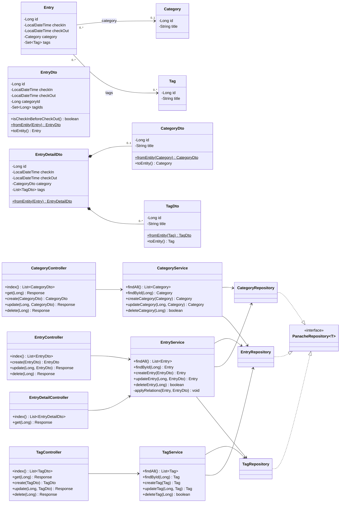
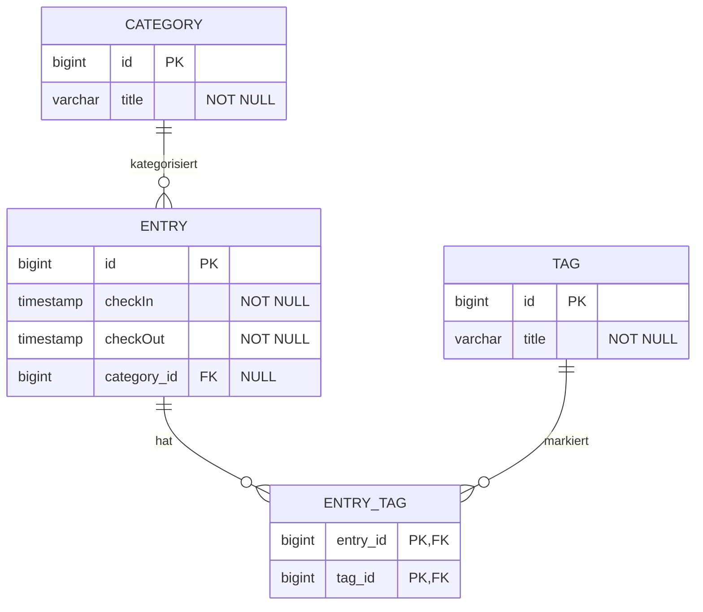

# Diagramme Punchclock

## UML-Klassendiagramm

## ERD (Datenbankschema)

- Ein `Entry` hat höchstens eine `Category` (`category_id` ist nullable); eine `Category` kann von beliebig vielen Entries referenziert werden.
- `Entry` ↔ `Tag` ist n:m und wird über die Join-Tabelle `entry_tag` abgebildet.
